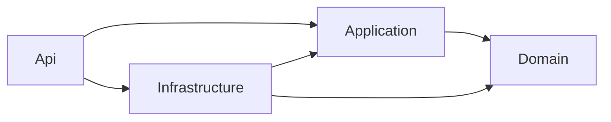

# Architecture

Clean Architecture on .NET 10 with DDD building blocks and CQRS Lite. Every
rule below is enforced by the build, an architecture test or `scripts/verify`.

## Dependency rule

- Domain references nothing. Application references Domain. Infrastructure
  references Application and Domain. Api is the composition root and holds no
  business logic.
- Interfaces live inside (write repositories and `IUnitOfWork` in Domain; read
  repositories, `ISecurityContext`, `IPasswordHasher` in Application);
  implementations live in Infrastructure.
- Application and Domain never reference EF Core or any persistence package.

## Request flows

- **Command** (write): controller -> `ICommandHandler` -> Logging -> Validation
  -> handler -> write repository (Domain interface) + aggregate method ->
  `IUnitOfWork` -> `AppDbContext`. Expected failures come back as `Result` and
  are mapped once by `ErrorResults` to ProblemDetails.
- **Query** (read): controller -> `IQueryHandler` -> Logging -> Validation ->
  handler -> `I<Name>ReadRepository` (Application interface) -> Infrastructure
  read repository (`AsNoTracking`, `Select` to DTO) -> raw DTO or
  `PagedResult<T>`.
- The full walkthrough, file locations and checklists: `docs/sample-flow.md`.

## Cross-cutting concerns

| Concern | Where | Decision |
| --- | --- | --- |
| Validation | Application pipeline (FluentValidation) | ADR 0001 |
| Errors | `Result`/`Error`, `AppException`, `ErrorResults`, `GlobalExceptionHandler` | ADR 0004, 0005 |
| Identity | JWT bearer (claim mapping off) -> `TokenVersionMiddleware` -> `SecurityContextMiddleware` -> `ISecurityContext` | ADR 0007, 0014 |
| Shared security state | Redis: token versions, shared rate limit | ADR 0013, 0014, 0015 |
| Persistence | `AppDbContext`, soft-delete filter, audit interceptor (`TimeProvider`), `RowVersion` | ADR 0004 (conflicts) |
| Null safety | NullGuard.Fody, `Mode=NullableReferenceTypes` | ADR 0008 |
| DI | `Configure*` in Application/Infrastructure, `Add*`/`Use*` in Api | ADR 0010 |
| Configuration | Options + `ValidateOnStart()`; secrets in user-secrets or environment variables | coding-standards.md |
| API contract | `docs/openapi.json`, generated and checked by verify | ADR 0009 |
| Database TLS | `Encrypt=false` only in Development/Testing | ADR 0011 |
| Dependencies | central versions, NuGetAudit, transitive security pins | ADR 0003, 0012 |
| Logging | Serilog per host (`preserveStaticLogger: true`), `[LoggerMessage]` | coding-standards.md |
| Security baseline | HTTPS/HSTS, security headers, CORS, rate limiting and trusted forwarded headers from Options, `/health` | security rules, ADR 0015 |

## Authentication and Redis

Full design: `docs/auth-design.md`; decisions: ADR 0013, 0014, 0015.

- **Sign-in.** `AuthController` (`register`, `login`, `refresh`, `logout`, `me`)
  calls command and query handlers like any feature. The access token is a JWT
  valid 10 minutes with a `tv` (token version) claim; the refresh token is random,
  stored only as a hash, rotated on every use (reuse detection revokes the
  token's family, the chain of one login, ADR 0016) and travels only in an
  HttpOnly cookie.
- **Per request.** Pipeline order: `UseAuthentication` -> `TokenVersionMiddleware`
  -> `SecurityContextMiddleware` -> `UseAuthorization`. The middleware compares
  the token's version with the current one: Redis key
  `auth:token-version:<userId>`, loaded from SQL Server on a miss, expiring one
  hour after it is written. A stale token gets 401 `auth.token_revoked`; Redis
  unreachable gets 503 `auth.unavailable` (fail closed).
- **Role change.** `PUT /api/users/{id}/role` (Admin) writes the new version to
  Redis first, then saves the user and revokes the refresh tokens in one
  `SaveChangesAsync`.
- **Rate limiting.** The per-IP limit (and a stricter one for login and register)
  is a fixed-window counter in Redis shared by all instances; any Redis error
  fails open to per-instance limits. `/health` checks the database and Redis.
- **Redis scope.** Only token versions and rate-limit counters; any other use
  needs a new ADR. Only Infrastructure references StackExchange.Redis;
  Application sees `ITokenVersionStore`.

## Projects

| Project | Role | References |
| --- | --- | --- |
| `src/Domain` | Aggregates, value objects, `Result`/`Error`, `AppException`, `IUnitOfWork`, write repository interfaces | nothing |
| `src/Application` | CQRS Lite (own `ICommand`/`IQuery` and handlers), Logging -> Validation pipeline, list query base, read repository interfaces, security context | Domain |
| `src/Infrastructure` | EF Core, repositories, read repositories, security implementations | Application, Domain |
| `src/Api` | Composition root, controllers, middleware, ProblemDetails mapping | Application, Infrastructure |
| `tests/UnitTests` | Domain and Application tests | Domain, Application, WeavingProbe |
| `tests/IntegrationTests` | Real host (`WebApplicationFactory`) and SQL Server (Testcontainers) | Api, Infrastructure |
| `tests/ArchitectureTests` | NetArchTest rules | all src |
| `tests/WeavingProbe` | Woven NON-test library with NullGuard probe members | nothing |

## Design notes

### Application and null safety

- **Security context in Application.** `SecurityContext` implements both
  `ISecurityContext` and `ISecurityContextSetter` in Application (pure claims
  logic). The Api middleware calls `SetPrincipal` once per request. See ADR 0007.
- **`SetPrincipal` naming.** The setter method was renamed from `Set` (CA1716,
  VB keyword).
- **NullGuard.** `Mode="NullableReferenceTypes"`, flags `Arguments | ReturnValues`.
  Known gap: non-nullable `ValueTask<T>` results are not checked; use `Task<T>`
  for non-nullable async results. See ADR 0008.
- **tests/WeavingProbe.** Woven like src, referenced only by UnitTests, never
  published. See ADR 0008.
- **Analyzer decisions.** Global `NoWarn` keeps only CA2007, CS1591, CA1062.
  All other decisions are scoped; the full table with reasons is in
  `docs/coding-standards.md`.

### Security, environments and configuration

- **Security context stays in Application** (ADR 0007). The only caller of
  `SetPrincipal` is `Api/Middleware/SecurityContextMiddleware`, placed between
  `UseAuthentication` and `UseAuthorization`. JWT inbound claim mapping is off,
  so `sub` and `role` arrive unchanged (proven with a real signed token).
- **Environments.** `Development` (local run, dev-only auto-migration, Swagger UI),
  `Testing` (integration tests via `ApiFactory`; `Encrypt=false` allowed; no
  auto-migration), anything else = production rules.
- **Database TLS** (ADR 0011): `Encrypt=false` only in Development and Testing;
  the certificate-trust keyword is forbidden and checked by `scripts/verify`.
- **Transitive security pin** (ADR 0012): `System.Security.Cryptography.Pkcs`
  10.0.14 via CPM transitive pinning.
- **Local tools.** `dotnet-ef` 10.0.14 is pinned in `dotnet-tools.json` at the
  backend root (SDK 10 writes the manifest there, not to `.config/`).
- **Serilog** uses `preserveStaticLogger: true`: each host logs through its own
  logger instance. The default wrote through the global static `Log.Logger`,
  so with several test hosts in one process the events reached another host's
  sinks (found by the 500-logging test).
- **No authorization fallback policy.** It was tried and removed: it turned
  unknown routes into 401 instead of 404. Every action must declare
  `[Authorize]` or `[AllowAnonymous]` (architecture test 5).
- **Composition placement.** JWT, CORS, rate limiting, security headers and the
  `/health` mapping are Api `Add*`/`Use*`; the password hasher and the database
  health check are Infrastructure `Configure*`.
- **ADR index:** `docs/adr/README.md`.

### Local runtime and API contract

- **SQL Server bound to loopback only.** `docker-compose.yml` publishes
  `127.0.0.1:${DB_PORT}:1433` (Compose short syntax `[IP:]HOST:CONTAINER`). After
  the change the API could not connect: on Windows `localhost` resolves to `::1`
  first, and `::1:1433` is refused because the port is published on IPv4 only.
  `Database:Host` is therefore `127.0.0.1` in `appsettings.json`. Testcontainers
  is unaffected (its own host and port).
- **OpenAPI generation false success.** The build-time generator can fail while
  `dotnet build` still reports success. The generate scripts delete the old file
  first and fail when the new one is missing or empty (ADR 0009).
- **`[Produces]` bug.** A class-level `[Produces("application/json")]` on
  `SamplesController` overwrote `application/problem+json` on error responses;
  found by a test and removed. Content types are documented per status with
  `[ProducesResponseType(..., "application/problem+json")]`.
- **Nullable request DTOs.** HTTP bodies bind to Api request records with
  nullable fields (`CreateSampleRequest`). A missing value then reaches
  FluentValidation (400 with an `errors` map) instead of NullGuard throwing during
  JSON deserialization (which would be a 500). MVC's automatic 400 (malformed
  JSON) also gets `errorCode: validation.failed`.
- **Query binding.** `ListSamplesRequest.SortBy` keeps an empty value
  (`ConvertEmptyStringToNull = false`) so `sortBy=` is rejected by the whitelist.
- **Generate scripts.** `scripts/generate-openapi.sh` / `.ps1` are the
  one-line regenerate command and are used by both verify scripts.
- **Public Api surface.** CA1515 is off only for `src/Api/Controllers/**.cs`;
  the architecture test `PublicTypesInApi_OnlyInControllersOrContracts` keeps
  every other Api type internal.
- **Swagger UI and `/openapi/v1.json`** are mapped in Development only
  (Production returns 404, proven by a test).

## Verified platform facts

Facts the design relies on, each settled from official documentation or a real
run (2026-11), not from memory:

| Question | Answer |
| --- | --- |
| Fody/NullGuard on net10.0; one config for all projects? | Works (build log shows the weaver). One root `FodyWeavers.xml`, fed to every project through `WeaverConfiguration`; without it a single-project build created a per-project copy |
| AutoMapper 14.x | Dropped: 14.0.0 has GHSA-rvv3-g6hj-g44x (high); the fixed versions are commercial (ADR 0003) |
| Creating a `.slnx` | `dotnet new sln -f slnx` (slnx is the default on SDK 10.0.401) |
| Build-time OpenAPI on net10.0 | `Microsoft.Extensions.ApiDescription.Server` with `OpenApiDocumentsDirectory`; OpenAPI 3.1 by default (ADR 0009) |
| Claude Code hook shell on Windows | Git Bash (PowerShell only when Git Bash is missing); per-hook `"shell": "bash"`, so the hook is `.sh` |
| `IsTestProject` in `Directory.Build.props` | Not available there (set later by package props); set explicitly in each test csproj and read in `Directory.Build.targets` |
| `IHostApplicationBuilder` in Application | `Microsoft.Extensions.Hosting.Abstractions`; no persistence package needed |
| How Api `Add*` methods get configuration | `Add*(this IServiceCollection, IConfiguration)`, bound immediately to Options with `ValidateOnStart()` |
| `IExceptionHandler` on .NET 10 | Still the documented approach; a client abort is answered 499 by the framework middleware before handlers run |
| Compose required variables | `${VAR:?message}`; works in values and in the top-level `name`, not in keys (service names) |
| `dotnet package list --vulnerable` exit code | 0 even with findings, so the script parses `--format json`; NuGetAudit also fails restore |
| Testcontainers on GitHub Actions | Works on the hosted Ubuntu runner (CI green); the SQL Server image is pinned explicitly |
